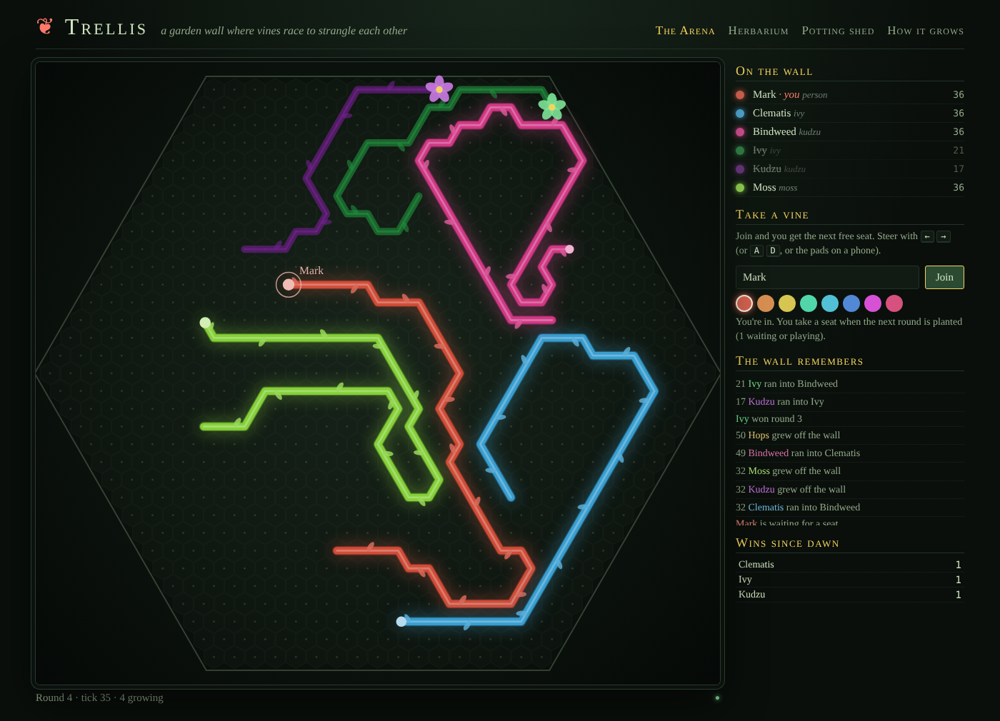
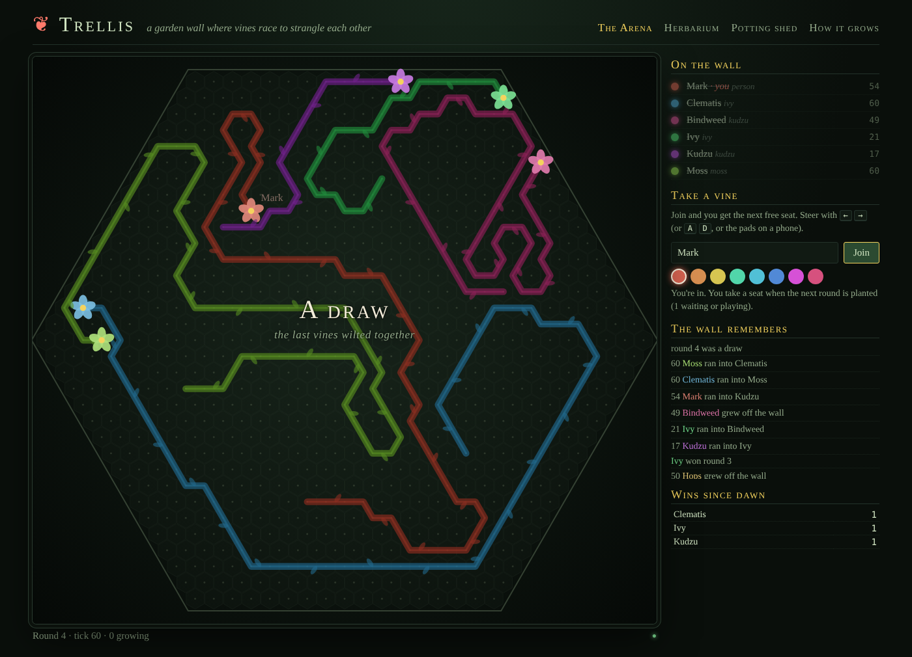
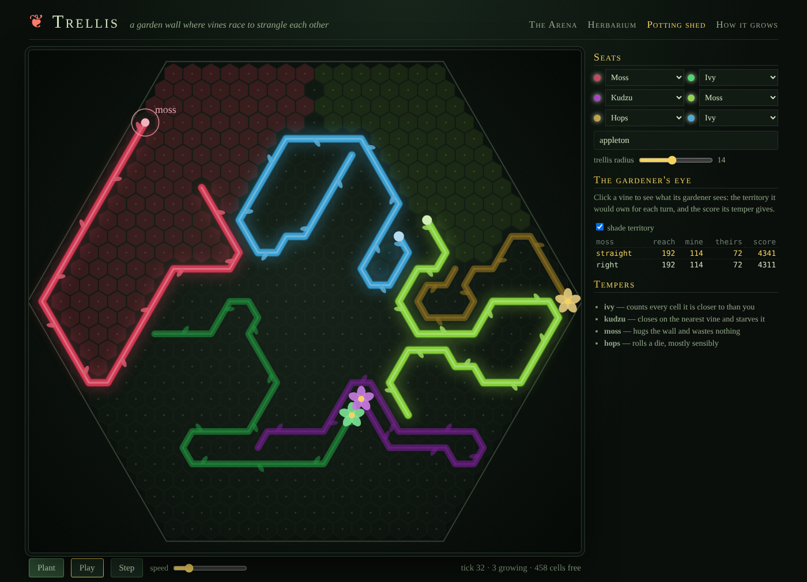
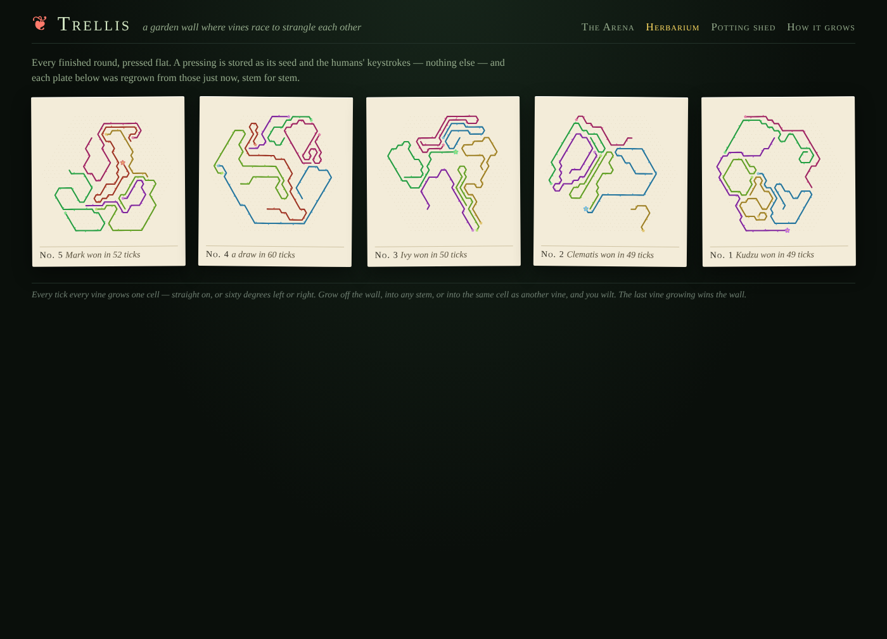
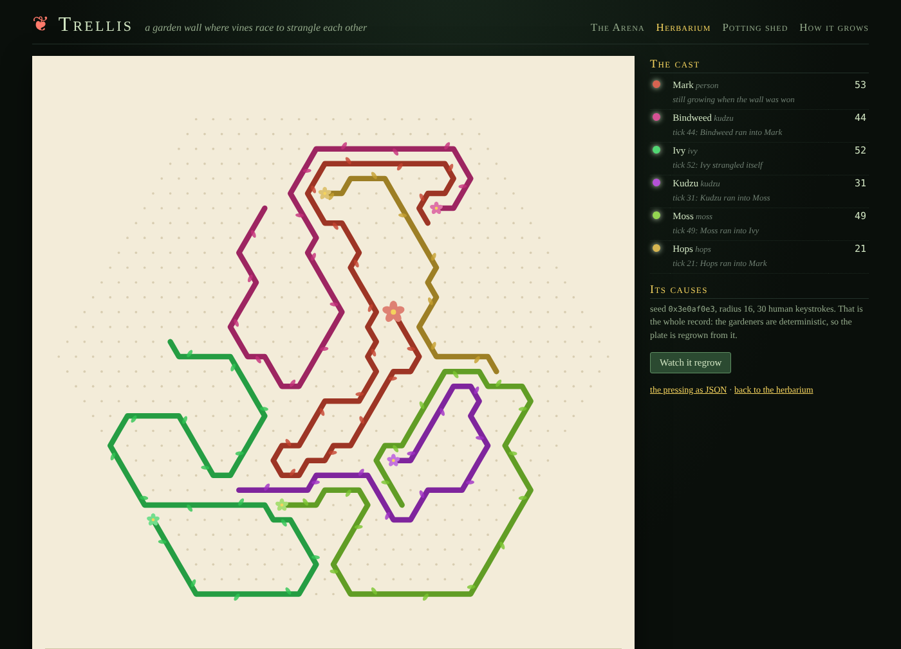

# Trellis

**A garden wall where vines race to strangle each other.**

> **`./verify.sh` is the authoritative gate.** It runs the pinned toolchain
> (1.97.1), fmt, clippy (pedantic + nursery), every test including the
> `#[sim_test]` Arena run, the JS-parity check, a boot-and-play end-to-end
> through the CSRF layer — and **Verus over `verus/`**. The gates run during
> the cloud build are a weaker pre-check: same toolchain, but a different
> machine and no Verus at all.



Six vines sprout on a hexagonal trellis of 817 cells. Every tick every vine
grows one cell — straight on, or sixty degrees left or right. Grow off the
wall, into any stem (your own included), or into the same cell as another vine
at the same instant, and you wilt and bloom where you died. The last vine
growing wins the wall.

The other vines are **gardeners**: one-move-lookahead searches that flood the
wall to measure room and split it into Voronoi territory, then score by temper.
**Ivy** hoards territory, **Kudzu** closes on the nearest vine and starves it,
**Moss** hugs walls, **Hops** rolls a die. The moment a gardener is sealed off
from everyone, it stops fighting and starts *packing* — coiling into its pocket
to outlast the rest.

## Run it

```sh
cargo run --release -p trellis-app
# open http://localhost:3000 — open it twice: the Arena is shared
```

No database, no Docker, no keys. Join with a name, take the next free seat,
steer with ← → (A D, or the pads on a phone).

## What works today

- **The Arena** (`/`) — rounds that never stop, planted, grown and pressed on
  a 125 ms beat; every tick goes to every browser over Autumn live events
  (SSE); people queue for seats and steer through CSRF-protected POSTs; a log
  of who strangled whom, and wins since dawn.
- **The Herbarium** (`/herbarium`) — every finished round as a botanical
  plate. A pressing is stored as *seed + seats + the humans' keystrokes*, and
  every plate is regrown from that on each request. `/pressing/{n}` shows the
  cast with epitaphs and replays the growth.
- **The Potting Shed** (`/shed`) — the whole engine running in the browser.
  Seat any mix of yourself and gardeners, seed with a word, pick a radius,
  step or play. **The gardener's eye** shades the wall by live Voronoi
  territory and shows the selected gardener's reach / territory / score for
  each turn, including when it has switched to packing.
- **How it grows** (`/about`) — the rules and what is proved.

| | |
|---|---|
|  |  |
|  |  |

## How it is built

```mermaid
flowchart LR
  subgraph trellis [crates/trellis — pure engine, no IO]
    hex[hex: trellis + neighbours] --> garden[garden: simultaneous tick]
    garden --> gardener[gardener: flood, Voronoi, tempers]
    gardener --> round[round: seats, die, keystrokes, pressings]
  end
  subgraph app [crates/trellis-app — autumn-web 0.9]
    beat[tokio beat loop 125ms] --> arena[Arena state machine]
    arena -->|channels: garden| sse[/stream SSE/]
    routes[join / steer / leave + CSRF] --> arena
    arena --> herb[herbarium: regrow on read]
  end
  round --> arena
  js[engine.js — bit-identical port] -.parity.js.- round
```

- `crates/trellis` — the engine. `hex`, `garden` (the rules), `gardener` (the
  bots), `round` (seats, the shared die, pressings), `rng` (mulberry32).
- `crates/trellis-app` — the Arena (an `AppState` extension, no clock of its
  own), routes, Maud pages, the canvas renderer and the engine port.
- `verus/src/trellis.rs` — the verified model. `docs/SPEC.md` §5 ranks each
  obligation by how confident I am it verifies as written.
- `docs/adr/0001-the-arena-lives-in-memory.md` — why there is no database, and
  why a pressing is its causes.

## What is proved, and what is tested

In Verus, over a pure model of one tick: survivors never share a target; stems
are forever; survivors land where they reached; nothing else changes; a tick
with *s* survivors fills exactly *s* cells; therefore any run of growing ticks
is no longer than the wall has cells (every round ends); no turn reverses a
heading; stepping across a heading and back is the identity.

In tests: the same laws on arbitrary plantings and turn scripts (proptest, 400
cases), gardeners always finishing within the bound and regrowing stem for
stem, arbitrary human keystrokes surviving a JSON round trip and regrowing,
the Arena planting and pressing round after round on Autumn's **simulated
clock** (`tests/sim_arena.rs`, ten virtual minutes per run), the HTTP surface,
and the browser engine making the same choice as Rust on every tick
(`tools/parity.js`, 24 rounds, ~4,800 stem cells).

## Where this could go

- **Gardeners that learn.** The scoring weights are six integers per temper. A
  Harvest-driven tournament that runs overnight and breeds them would wake up
  to new tempers with names.
- **Team vines** that may cross each other's stems, and a 3-v-3 Arena.
- **Thorns and seeds** on the wall — cells that kill, cells that let you fork.
- **A durable herbarium.** Pressings are tens of bytes; a single SQLite table
  would keep them across restarts and let plates be ranked and shared.
- **Tauri + a gamepad.** It is a couch game waiting to happen.
- **Lower latency steering** over the WebSocket feature instead of POSTs, for
  faster beats.
